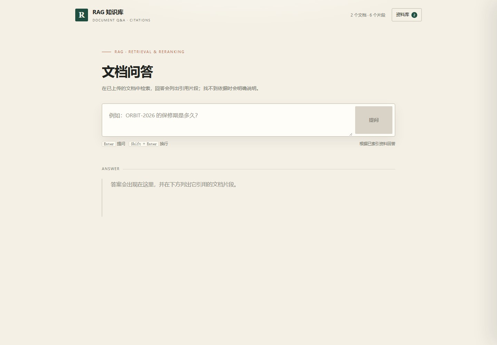
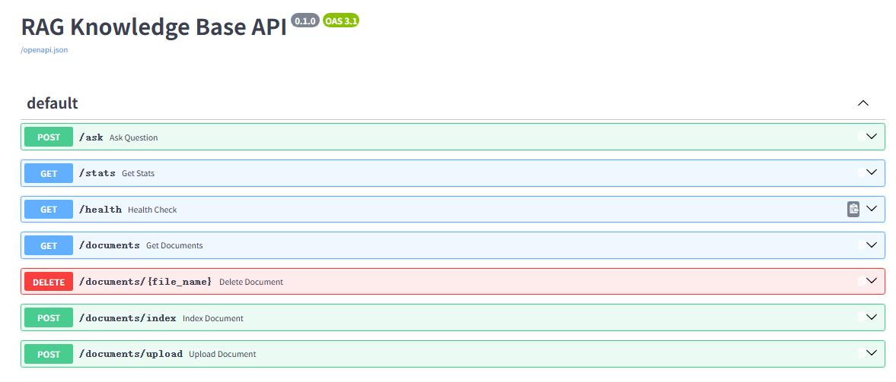
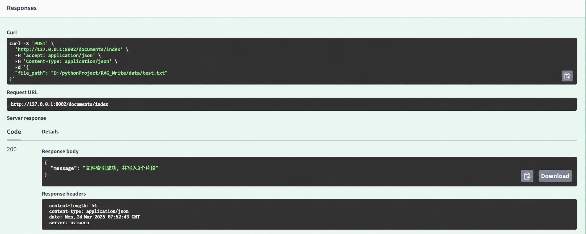
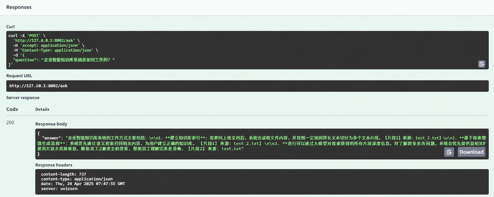

# 基于 LangChain + Chroma + FastAPI 的 RAG 知识库问答系统

# LangChain RAG FastAPI

[](https://github.com/adrianwen98/langchain-rag-fastapi/actions/workflows/tests.yml)

## 项目简介

本项目基于 LangChain 构建了一个可服务化的 RAG（Retrieval-Augmented Generation，检索增强生成）知识库问答系统。

系统支持本地 TXT、Markdown、文本型 PDF 和 DOCX 文档上传与索引，通过文本切分、Embedding 向量化、Chroma 向量存储，以及 Dense Retrieval 与 BM25 Sparse Retrieval 组成的 Hybrid Retrieval，实现基于私有知识库的智能问答。

检索阶段使用 RRF（Reciprocal Rank Fusion）融合 Dense 与 BM25 的排序结果，并通过 CrossEncoder Reranker 对候选文档进行二次相关性排序与阈值过滤，以减少弱相关内容进入最终上下文。

项目采用 FastAPI 提供 RESTful API 服务，LangChain 负责 RAG 流程编排，Chroma 作为向量数据库，DeepSeek 作为大语言模型，并使用 Pytest 完成接口自动化测试。

同时支持 Docker 与 Docker Compose 容器化部署，通过 Docker Volume 持久化向量数据与上传文档，并配置 Healthcheck 检测服务运行状态。


## 项目展示

### 内置问答页面



页面由 FastAPI 直接提供，无需 Node 构建；上传、文件列表、提问和引用展示都在同一个页面完成。

### Swagger API



### 文档索引



### RAG 问答效果




## 技术栈

- Python
- FastAPI
- LangChain
- ChromaDB
- HuggingFace Embedding
- BM25 / rank-bm25
- jieba
- Sentence Transformers CrossEncoder
- RRF（Reciprocal Rank Fusion）
- DeepSeek API
- Pytest
- Docker
- Docker Compose
- GitHub Actions


## 项目结构

```text
RAG_Write/
│
├── .github/
│   └── workflows/
│       └── tests.yml                 # GitHub Actions CI
│
├── data/
│   ├── test_files/
│   │   └── empty.txt                 # 空文件测试数据
│   ├── test.txt                      # 示例知识库文档
│   └── test_2.txt                    # 示例知识库文档
│
├── docs/
│   └── images/
│       ├── index.jpg
│       ├── rag_answer.jpg
│       ├── rag_ui.jpg                # 内置问答页面截图
│       └── swagger.jpg               # README 项目展示图片
│
├── evaluation/
│   └── retrieval_eval.py             # 离线检索评测
│
├── tests/
│   ├── test_api.py                   # FastAPI 自动化测试
│   ├── test_formats.py               # TXT / Markdown / PDF / DOCX 解析与上传测试
│   └── test_index_consistency.py     # 索引 ID、更新失败回滚与空库检索测试
│
├── static/
│   └── index.html                    # 单页问答前端（FastAPI 直接提供）
│
├── api_main.py                       # FastAPI 接口层
├── langchain_rag_service.py          # RAG 业务逻辑层
├── langchain_file_utils.py           # LangChain 文档加载与切分
├── file_utils.py                     # 文件读取工具
│
├── bm25_retriever.py                 # BM25 稀疏检索
├── hybrid_retriever.py               # Dense + BM25 + RRF 混合检索
├── reranker.py                       # CrossEncoder 重排序与相关性过滤
├── retrieval_pipeline.py             # 最终检索 Pipeline
│
├── .env.example                      # 环境变量示例
├── .gitignore
├── .dockerignore
├── Dockerfile                        # Docker 镜像构建配置
├── compose.yaml                      # Docker Compose 服务配置
├── requirements.txt                  # Python 项目依赖
└── README.md
```


## 系统架构

本项目采用分层架构设计，将 API 接口层、RAG 业务逻辑层、文档处理、检索 Pipeline、向量存储以及大语言模型调用进行拆分。

整体架构如下：

```text
                         用户请求
                            ↓
                 FastAPI API 层
                    （api_main.py）
                            ↓
                 RAG 业务逻辑层
              （langchain_rag_service.py）
                     ↙              ↘

              文档索引流程           问答检索流程
                   ↓                     ↓
          文件读取 / 文档切分       Retrieval Pipeline
          （file_utils.py）      （retrieval_pipeline.py）
     （langchain_file_utils.py）          ↓
                   ↓              ┌───────────────┐
          HuggingFace Embedding   │               │
                   ↓          Dense Retrieval   BM25 Retrieval
               ChromaDB          （Chroma）    （bm25_retriever.py）
                                     │               │
                                     └───────┬───────┘
                                             ↓
                                         RRF Fusion
                                  （hybrid_retriever.py）
                                             ↓
                                  CrossEncoder Reranker
                                     （reranker.py）
                                             ↓
                                  Relevance Threshold
                                             ↓
                                    Final Documents
                                             ↓
                                      Prompt 构建
                                             ↓
                                      DeepSeek LLM
                                             ↓
                                         最终回答
```

## RAG 工作流程

系统主要包含 Indexing、Retrieval、Generation 三个阶段。


### 1. Indexing（索引阶段）

用户上传或指定文档后：

1. 读取文件内容
2. 使用 `RecursiveCharacterTextSplitter` 对文本进行切分
3. 将文本片段转换为 `Document` 对象
4. 使用 HuggingFace Embedding 模型生成向量
5. 将向量及 metadata 存入 Chroma 向量数据库

流程：

```text
文档
 ↓
文本切分
 ↓
Document
 ↓
Embedding
 ↓
Chroma Vector Store
```


### 2. Retrieval（检索阶段）

用户提出问题后，系统同时执行语义检索与关键词检索：

1. 使用 Embedding + Chroma 执行 Dense Retrieval
2. 使用 BM25 执行 Sparse Retrieval
3. 使用 RRF 融合两路检索结果
4. 使用 CrossEncoder Reranker 对候选文档重新评分排序
5. 通过 relevance threshold 过滤弱相关候选
6. 将最终文档片段送入 Generation 阶段

流程：

```text
                    ┌─ Dense Retrieval（Chroma）
用户问题 ───────────┤
                    └─ BM25 Retrieval
                             ↓
                        RRF Fusion
                             ↓
                   CrossEncoder Reranker
                             ↓
                    Relevance Threshold
                             ↓
                   Final Retrieved Context
```


### 3. Generation（生成阶段）

系统将用户问题与检索到的知识片段共同构造成 Prompt，并发送给大语言模型生成最终回答。

流程：

```text
Question + Retrieved Context
            ↓
      Prompt Template
            ↓
       DeepSeek LLM
            ↓
          Answer
```

## 检索评测

项目提供离线 Retrieval Evaluation，用于比较不同检索策略在有答案问题召回以及无答案问题拒绝上的表现。

当前评测集包含 9 条样例：

- 6 条知识库中存在答案的问题
- 3 条知识库中不存在答案的问题

对比结果：

| Retrieval Strategy | Answerable Hit | No-answer Rejection | Overall |
| --- | ---: | ---: | ---: |
| Dense Retrieval | 5 / 6 | 3 / 3 | 8 / 9 |
| Dense + BM25 + RRF | 6 / 6 | 0 / 3 | 6 / 9 |
| Hybrid + Reranker + Threshold | 6 / 6 | 3 / 3 | 9 / 9 |

评测结果表明：

Dense Retrieval 使用较严格的相似度阈值时具有较好的无答案拒绝能力，但存在语义相关问题漏召回的情况。

加入 BM25 与 RRF 后，有答案问题召回由 5/6 提升至 6/6，但 BM25 也会因为关键词重合召回部分弱相关文档，从而降低无答案问题的拒绝能力。

进一步使用 CrossEncoder Reranker 对候选文档重新评分，并根据离线评测设置 relevance threshold 后，可以过滤明显弱相关的候选文档，在当前评测集上同时保持完整召回与无答案拒绝。

> 当前结果基于 9 条小规模离线评测样本，`score_threshold` 同样基于当前样本进行初步调节，因此该结果主要用于验证检索 Pipeline 的有效性，而不代表通用场景下的准确率。

## 核心功能

### 1. 文档索引

支持将本地 `.txt`、`.md`、文本型 `.pdf` 和 `.docx` 文档加入知识库：

- 文档读取
- 文本切分
- 向量化
- Chroma 持久化存储
- 重复索引检测


> PDF 使用 PyMuPDF 按页抽取文字，chunk metadata 会保留页码；扫描版 PDF 没有文字层时会明确拒绝，不做 OCR。Markdown 按纯文本读取，不使用标题层级重排。DOCX 用 python-docx 读取段落和表格文字；Word 没有稳定页码，引用只显示文件名。旧版 .doc 不支持。

### 2. 知识库检索

支持：

- Dense Retrieval（Chroma 语义检索）
- BM25 Sparse Retrieval（关键词检索）
- RRF 多路检索结果融合
- CrossEncoder Reranker 二次排序
- relevance threshold 弱相关候选过滤


### 3. RAG 问答

用户输入问题后：

- 自动检索相关知识片段
- 基于检索结果生成回答
- 返回来源片段信息
- 支持知识来源追踪


### 4. 文件管理

支持：

- 上传文件
- 删除文件
- 重复文件检测
- 索引状态管理
- 同步删除对应向量数据


### 5. 接口测试

使用 Pytest 对 API 进行自动化测试，覆盖：

- 正常请求
- 参数校验失败
- 文件不存在
- 文件冲突
- 模型调用异常
- 文档索引流程


## API 接口

项目通过 FastAPI 提供 RESTful API 服务。


### 1. 健康检查

`GET /health`

用于检查服务运行状态。

返回示例：

```json
{
  "status": "ok"
}
```


---

### 2. 查看向量库状态

`GET /stats`

返回当前 Chroma 向量数据库中的向量数量。

返回示例：

```json
{
  "vector_count": 3
}
```

> `vector_count` 会根据当前知识库中的文档数量动态变化。


---

### 3. 查询已索引文件

`GET /documents`

用于查看当前知识库中已经索引的文件。

支持关键词筛选，例如：

```text
GET /documents?keyword=test
```

返回示例：

```json
{
  "files": [
    "test.txt",
    "test_2.txt"
  ]
}
```


---

### 4. 文档索引

`POST /documents/index`

将指定的 `.txt`、`.md`、文本型 `.pdf` 或 `.docx` 文件加入知识库。

请求示例：

```json
{
  "file_path": "data/test.txt"
}
```

处理流程：

```text
文件读取
 ↓
文本切分
 ↓
Embedding 向量生成
 ↓
Chroma 向量存储
```


---

### 5. 文件上传

`POST /documents/upload`

上传新的 `.txt`、`.md`、文本型 `.pdf` 或 `.docx` 文件，并自动完成索引。

支持：

- 文件类型校验（TXT / Markdown / 文本型 PDF / DOCX）
- 文件大小限制
- 同名文件检测
- 自动建立向量索引


---

### 6. 删除文件

`DELETE /documents/{file_name}`

删除指定文件，同时删除 Chroma 中对应的向量数据。


---

### 7. 知识库问答

`POST /ask`

根据知识库内容回答用户问题。

请求示例：

```json
{
  "question": "企业智能知识库系统是如何工作的？"
}
```

返回示例：

```json
{
  "answer": "企业智能知识库系统通过文档管理、向量检索和大语言模型实现智能问答。"
}
```


## 项目启动

### 1. 环境变量配置

复制 `.env.example` 为 `.env`，并配置 DeepSeek API Key：

```env
DEEPSEEK_API_KEY=your_api_key_here
```

`.env` 已加入 `.gitignore` 和 `.dockerignore`，不会被提交到 Git 仓库或打包进 Docker 镜像。


### 2. 本地启动

安装项目依赖：

```bash
pip install -r requirements.txt
```

启动 FastAPI 服务：

```bash
uvicorn api_main:app --host 0.0.0.0 --port 8002
```

启动成功后访问：

```text
http://127.0.0.1:8002/        # 问答页面
http://127.0.0.1:8002/docs    # Swagger 接口调试
```


### 3. Docker Compose 启动

项目支持通过 Docker Compose 构建并运行完整服务。

构建并启动：

```bash
docker compose up -d --build
```

查看服务状态：

```bash
docker compose ps
```

当容器状态显示 `healthy` 后，访问：

```text
http://localhost:8002/        # 问答页面
http://localhost:8002/docs    # Swagger 接口调试
```

查看实时日志：

```bash
docker compose logs -f
```

停止并移除服务：

```bash
docker compose down
```

Chroma 向量数据与 `data/` 下的上传文档分别通过 Docker Volume 持久化。即使重新创建容器，已经建立的向量索引和原始文档都仍然保留。


## 自动化测试

项目使用 Pytest 对 FastAPI 接口进行自动化测试。

运行：

```bash
pytest tests -v
```

当前测试覆盖：

- 健康检查接口
- 向量库状态查询
- 文件列表查询
- Query 参数校验
- 文件不存在处理
- 文件冲突处理
- 模型服务异常处理
- 文档索引接口
- Markdown / 文本型 PDF / DOCX 解析、页码引用与 Word 表格提取
- 单页问答前端路由
- 扫描版 PDF 拒绝、旧版 .doc 拒绝与上传回滚
- 同名不同文件的内容相同文档不会共用向量 ID
- 索引更新先写后删、写入失败时保留旧索引
- 空知识库的 BM25 检索返回空结果

测试结果：

```text
23 passed
```


## 项目亮点

- 基于 LangChain 构建完整 RAG 流程，实现文档索引、Hybrid Retrieval、候选重排序以及大语言模型生成。

- 使用 FastAPI 将 RAG 能力服务化，提供文档管理、知识库检索和智能问答 RESTful API。

- 使用 Chroma 作为向量数据库，通过 metadata 保存文档来源，实现回答内容的来源追踪。

- 构建 Dense + BM25 Hybrid Retrieval，同时结合语义相似度与关键词匹配能力，提高知识片段召回率。

- 使用 RRF（Reciprocal Rank Fusion）融合 Dense Retrieval 与 BM25 的排序结果，避免直接比较不同检索器的原始分数。

- 使用 CrossEncoder Reranker 对候选文档进行二次相关性评分，并结合 relevance threshold 过滤弱相关上下文。

- 构建离线 Retrieval Evaluation，对 Dense、Hybrid、Hybrid + Reranker 三种检索策略进行对比，并分析召回率与无答案误召回之间的权衡。

- 对文档内容与文件名生成确定性且互不冲突的索引标识，支持重复索引检测；更新时先写入新向量、成功后再移除旧版本，写入失败不会丢失原有索引。

- 使用 Pytest 对 API 接口进行自动化测试，覆盖正常流程、参数异常、资源不存在以及模型服务异常等场景。

- 使用 Docker 与 Docker Compose 实现服务容器化部署，通过 Docker Volume 持久化 Chroma 向量数据与上传文档。

- 配置 Docker Healthcheck，通过 `/health` 接口检测 FastAPI 服务是否真正启动完成，而不仅仅判断容器进程是否运行。

- 使用 `.env` 管理敏感配置，并通过 `.gitignore` 与 `.dockerignore` 避免 API Key 被提交到仓库或打包进 Docker 镜像。